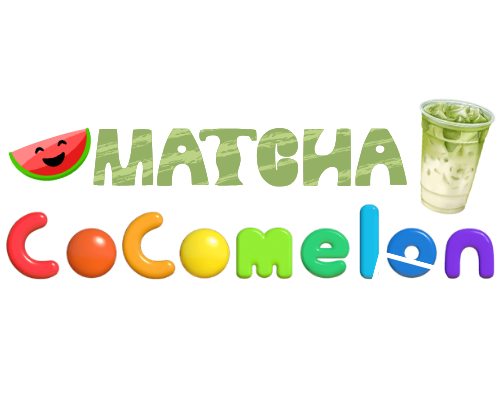

<div align="center">

<sub><a href="README.md">Polski</a> · <b>English</b></sub>

#  Matcha Cocomelon Mod

**A mod for MECCHA CHAMELEON — changes the whistle sound to "do you see me?".**

GUI installer (Windows) + a terminal, cross-platform one (Windows/Linux, Steam Proton).

[](../../releases/latest)
&nbsp;

&nbsp;




</div>

---

## What does it do?

It replaces the hero's whistle sound in **MECCHA CHAMELEON** with "do you see me?". The
installer finds the game in your Steam libraries on its own (Windows and Linux/Proton),
copies the mod files into the `Content/Paks` folder, and lets you uninstall it at any time,
restoring the original sound.

## Features

- 🖥️ **GUI** (PySide6, dark theme) — game detection, a "Browse…" button, an operation log,
  a single self-contained `.exe` (the mod is embedded inside, no ZIP to unpack).
  The program and the `.exe` file have their own icon (`icon.png` / `icon.ico`, the same logo
  as at the top).
- ⌨️ **Terminal installer** (`installer.py`) — retro memory-test look (green **OK** frame,
  red **ERROR**), runs on Windows and Linux with no dependencies beyond the stdlib.
- 🔍 **Steam auto-detection** — the registry (Windows) / common paths (Linux), parsing
  `libraryfolders.vdf` for additional libraries.
- ↩️ **Safe uninstall** — removes exactly the files shipped with the mod and restores the
  original sound.

---

## Quick start (Windows, GUI)

1. Download **`MatchaCocomelonMod-Instalator-v2.2.exe`** (the name includes the version)
   from the [Releases tab](../../releases/latest).
2. Run it. The file is not signed, so SmartScreen may warn you —
   "More info" → "Run anyway".
3. The program will detect the game folder on its own; if it doesn't, click **Browse…** and
   point it at the **MECCHA CHAMELEON** folder.
4. Click **Install**. Launch (or restart) the game and check.

## Terminal installer (Windows/Linux)

A cross-platform alternative without a GUI (Windows / Linux Steam Proton):

1. Download the ZIP archive from [Releases](../../releases/latest) and extract **all of its
   contents** into a single folder — the `mod` folder must sit next to the installer.
2. **Windows:** double-click `Zainstaluj.bat` (requires Python 3 in PATH) or the standalone
   `Zainstaluj.exe`. **Linux:** `./zainstaluj.sh` (or `python3 installer.py`).
3. Choose **Install** (`1`) — the installer will find the game itself or ask you to point it
   at the folder.

Skip the menu: `installer.py /install` or `installer.py /uninstall`.

## Running from source (GUI)

```bash
python -m venv venv
venv/bin/pip install -r requirements.txt   # Windows: venv\Scripts\pip
venv/bin/python installer_gui.py           # Windows: venv\Scripts\python
```

### Building your own `.exe`

On Windows with Python 3.10+ in PATH, `build.bat` is all you need. Result:
`dist\MatchaCocomelonMod-Instalator-v2.2.exe` — a single file (the name includes the
version), with the mod embedded inside (`--add-data "mod;mod"`), using the `icon.ico` icon
and no console. Release builds are produced by GitHub Actions
(`.github/workflows/release.yml`) after pushing a `v*` tag — the `.exe` name then takes the
version from the tag.

---

## Common problems

| Problem | Solution |
|---|---|
| No change in the game | Close the game completely and start it again — the mod loads at startup. |
| "Mod files not found" (terminal variant) | Extract the entire archive into one folder (the `mod` folder must be next to the installer). |
| "Game not found" | Click **Browse…** (GUI) or type the path manually. You can find the location in Steam: right-click the game → **Manage** → **Browse local files**. |
| The mod stopped working | Verifying the integrity of the game files in Steam removes mods — install it again. |

## Requirements

- The game **MECCHA CHAMELEON** on Steam
- **Windows 10/11** (GUI and terminal) or **Linux** (terminal only, Steam Proton)
- To run from source: **Python 3.10+** and (for the GUI) `PySide6`

## License

[MIT](LICENSE) — applies to the installer/GUI code. An unofficial fan mod, removable at any
time.
