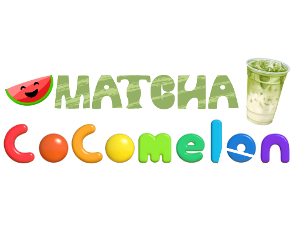

<div align="center">

# 🎵 Matcha Cocomelon Mod

**Mod do gry MECCHA CHAMELEON — zmienia dźwięk gwizdu na „widzisz mnie?".**

Instalator GUI (Windows) + terminalowy, wieloplatformowy (Windows/Linux, Steam Proton).

[](../../releases/latest)
&nbsp;

&nbsp;

&nbsp;




</div>

---

## Co to robi

Podmienia dźwięk gwizdu bohatera w **MECCHA CHAMELEON** na „widzisz mnie?". Instalator sam
wyszukuje grę w bibliotekach Steam (Windows i Linux/Proton), kopiuje pliki moda do folderu
`Content/Paks` i pozwala go w każdej chwili odinstalować, przywracając oryginalny dźwięk.

## Funkcje

- 🖥️ **GUI** (PySide6, ciemny motyw) — wykrywanie gry, przycisk „Przeglądaj…", log operacji,
  jeden samowystarczalny `.exe` (mod wbudowany w środku, bez rozpakowywania ZIP-a).
- ⌨️ **Terminalowy instalator** (`installer.py`) — retro wygląd testu pamięci (zielona ramka
  **OK**, czerwona **ERROR**), działa na Windows i Linux bez zależności spoza stdlib.
- 🔍 **Auto-wykrywanie Steam** — rejestr (Windows) / typowe ścieżki (Linux), parsowanie
  `libraryfolders.vdf` dla dodatkowych bibliotek.
- ↩️ **Bezpieczna deinstalacja** — usuwa dokładnie pliki dostarczone z modem, przywraca
  oryginalny dźwięk.

---

## Szybki start (Windows, GUI)

1. Pobierz **`MatchaCocomelonMod-Instalator.exe`** z [zakładki Releases](../../releases/latest).
2. Uruchom. Plik nie jest podpisany, więc SmartScreen może ostrzec —
   „Więcej informacji" → „Uruchom mimo to".
3. Program sam wykryje folder gry; jeśli nie, kliknij **Przeglądaj…** i wskaż folder
   **MECCHA CHAMELEON**.
4. Kliknij **Zainstaluj**. Uruchom (lub zrestartuj) grę i sprawdź.

## Instalator terminalowy (Windows/Linux)

Alternatywa bez GUI, wieloplatformowa (Windows / Linux Steam Proton):

1. Pobierz archiwum ZIP z [Releases](../../releases/latest) i wypakuj **całą zawartość**
   do jednego folderu — obok instalatora musi być folder `mod`.
2. **Windows:** dwuklik na `Zainstaluj.bat` (wymaga Pythona 3 w PATH) albo samodzielny
   `Zainstaluj.exe`. **Linux:** `./zainstaluj.sh` (lub `python3 installer.py`).
3. Wybierz **Zainstaluj** (`1`) — instalator sam znajdzie grę albo poprosi o wskazanie folderu.

Pominięcie menu: `installer.py /install` lub `installer.py /uninstall`.

## Uruchomienie ze źródeł (GUI)

```bash
python -m venv venv
venv/bin/pip install -r requirements.txt   # Windows: venv\Scripts\pip
venv/bin/python installer_gui.py           # Windows: venv\Scripts\python
```

### Zbudowanie własnego `.exe`

Na Windowsie z Pythonem 3.10+ w PATH wystarczy `build.bat`. Wynik:
`dist\MatchaCocomelonMod-Instalator.exe` — jeden plik, mod wbudowany w środku
(`--add-data "mod;mod"`), bez konsoli. Wersje release'owe buduje GitHub Actions
(`.github/workflows/release.yml`) po pushu taga `v*`.

---

## Najczęstsze problemy

| Problem | Rozwiązanie |
|---|---|
| Brak zmian w grze | Zamknij grę całkowicie i uruchom ponownie — mod ładuje się przy starcie. |
| „Nie znalazłem plików moda" (wariant terminalowy) | Wypakuj całą zawartość archiwum do jednego folderu (folder `mod` musi być obok instalatora). |
| „Nie znalazłem gry" | Kliknij **Przeglądaj…** (GUI) lub wpisz ścieżkę ręcznie. Lokalizację znajdziesz w Steam: prawy przycisk na grze → **Zarządzaj** → **Przeglądaj pliki lokalne**. |
| Mod przestał działać | Weryfikacja integralności plików gry w Steam usuwa mody — zainstaluj ponownie. |

## Wymagania

- Gra **MECCHA CHAMELEON** na platformie Steam
- **Windows 10/11** (GUI i terminal) lub **Linux** (tylko terminal, Steam Proton)
- Do uruchomienia ze źródeł: **Python 3.10+** i (dla GUI) `PySide6`

## Licencja

[MIT](LICENSE) — dotyczy kodu instalatora/GUI. Nieoficjalny mod fanowski, można
odinstalować w dowolnym momencie.
